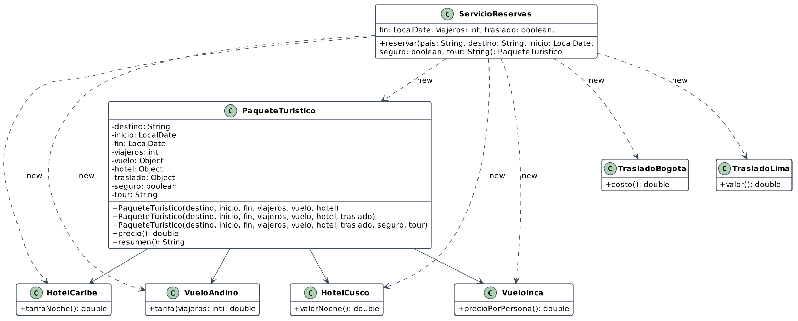

# Caso 01. Agencia de viajes: paquetes turísticos multipaís

**Dominio:** Turismo y comercio electrónico  
**Código inicial:** [`src/main/java/edu/ingsoft/actividad/creacionales/caso01/`](../../src/main/java/edu/ingsoft/actividad/creacionales/caso01/)

## 1. Contexto de la aplicación

«ViajaYa» es una agencia en línea que vende paquetes turísticos en Colombia y Perú. Un paquete combina un vuelo, un hotel y, opcionalmente, traslados aeropuerto–hotel, seguro de viaje y un tour guiado. Cada país trabaja con sus propios proveedores locales de vuelos, hoteles y traslados, y sus sistemas solo son compatibles entre sí dentro del mismo país.

El sitio web arma los paquetes a partir de lo que elige el cliente. En temporada alta se venden más de 3 000 paquetes diarios y el área comercial quiere lanzar paquetes predefinidos («Luna de miel», «Familiar») y abrir operación en México.

## 2. Problemática

La clase PaqueteTuristico tiene varios constructores con largas listas de parámetros, muchos de ellos opcionales, y los desarrolladores confunden el orden de los argumentos. Además, ServicioReservas decide con condicionales qué proveedor concreto instanciar en cada paso, según el país, y ya se produjo un incidente en producción: a un cliente de Perú se le asignó un traslado de un proveedor colombiano.

### Lo que reporta el equipo de desarrollo

- «Cada vez que agregamos un servicio opcional hay que crear otro constructor.»
- «En la última versión alguien invirtió las fechas de inicio y fin en una llamada al constructor y nadie lo notó.»
- «Para abrir México tendríamos que tocar todos los if de ServicioReservas.»
- «No hay forma de garantizar que vuelo, hotel y traslado sean del mismo país.»

## 3. Diagrama de clases inicial



> Fuente editable: [`diagrama-inicial.puml`](diagrama-inicial.puml) (PlantUML).

## 4. Código inicial

| Archivo | Ubicación |
|---|---|
| `VueloAndino.java` | [`src/main/java/edu/ingsoft/actividad/creacionales/caso01/VueloAndino.java`](../../src/main/java/edu/ingsoft/actividad/creacionales/caso01/VueloAndino.java) |
| `HotelCaribe.java` | [`src/main/java/edu/ingsoft/actividad/creacionales/caso01/HotelCaribe.java`](../../src/main/java/edu/ingsoft/actividad/creacionales/caso01/HotelCaribe.java) |
| `TrasladoBogota.java` | [`src/main/java/edu/ingsoft/actividad/creacionales/caso01/TrasladoBogota.java`](../../src/main/java/edu/ingsoft/actividad/creacionales/caso01/TrasladoBogota.java) |
| `VueloInca.java` | [`src/main/java/edu/ingsoft/actividad/creacionales/caso01/VueloInca.java`](../../src/main/java/edu/ingsoft/actividad/creacionales/caso01/VueloInca.java) |
| `HotelCusco.java` | [`src/main/java/edu/ingsoft/actividad/creacionales/caso01/HotelCusco.java`](../../src/main/java/edu/ingsoft/actividad/creacionales/caso01/HotelCusco.java) |
| `TrasladoLima.java` | [`src/main/java/edu/ingsoft/actividad/creacionales/caso01/TrasladoLima.java`](../../src/main/java/edu/ingsoft/actividad/creacionales/caso01/TrasladoLima.java) |
| `PaqueteTuristico.java` | [`src/main/java/edu/ingsoft/actividad/creacionales/caso01/PaqueteTuristico.java`](../../src/main/java/edu/ingsoft/actividad/creacionales/caso01/PaqueteTuristico.java) |
| `ServicioReservas.java` | [`src/main/java/edu/ingsoft/actividad/creacionales/caso01/ServicioReservas.java`](../../src/main/java/edu/ingsoft/actividad/creacionales/caso01/ServicioReservas.java) |
| `Demo.java` | [`src/main/java/edu/ingsoft/actividad/creacionales/caso01/Demo.java`](../../src/main/java/edu/ingsoft/actividad/creacionales/caso01/Demo.java) |

Ejecutar el escenario actual:

```bash
scripts/ejecutar.sh caso01
```

Salida actual (también en [`salida-esperada.txt`](salida-esperada.txt)):

```text
Cartagena | 2026-12-18→2026-12-22 | 2 viajero(s) | vuelo=VueloAndino hotel=HotelCaribe traslado=TrasladoBogota seguro=no tour=- | $2,165,000
Cusco | 2026-12-18→2026-12-22 | 2 viajero(s) | vuelo=VueloInca hotel=HotelCusco traslado=TrasladoBogota seguro=sí tour=Machu Picchu | $2,835,000
Santa Marta | 2026-12-22→2026-12-18 | 1 viajero(s) | vuelo=VueloAndino hotel=HotelCaribe traslado=- seguro=no tour=- | $-820,000
```

## 5. Nuevos requerimientos del negocio

Después de refactorizar, el diseño debe permitir incorporar los siguientes cambios. Impleméntelos y demuéstrelos en una clase `DemoNuevosRequerimientos`:

1. Abrir operación en México con sus propios proveedores de vuelo, hotel y traslado.
2. Ofrecer paquetes predefinidos «Luna de miel» (hotel 5 noches + traslado + tour) y «Familiar» (4 viajeros, seguro y traslado) que se armen siempre con los mismos pasos.
3. Validar al armar el paquete que la fecha de fin sea posterior a la de inicio y que haya al menos un viajero.
4. Agregar «alquiler de vehículo» como servicio opcional sin romper el código de los clientes existentes.

## 6. Preguntas orientadoras

1. ¿Qué grupos de objetos deben crearse siempre juntos y por qué?
2. ¿Qué partes de la construcción de un paquete son obligatorias y cuáles opcionales? ¿Cómo lo expresaría en el diseño?
3. ¿Qué clase debería decidir el país una sola vez y cómo se comunicaría esa decisión al resto del sistema?
4. ¿Cómo reutilizaría la secuencia de pasos de los paquetes predefinidos?

## 7. Entregables del caso

1. Informe `casos/caso-01-paquetes-turisticos/INFORME.md` diligenciado a partir de [`PLANTILLA_INFORME.md`](../../PLANTILLA_INFORME.md).
2. Diagrama de clases de la solución en `casos/caso-01-paquetes-turisticos/diagrama-solucion.puml` (y su PNG).
3. Código refactorizado en el paquete `edu.ingsoft.actividad.creacionales.caso01.solucion`, conservando el comportamiento correcto de `Demo` (verificable con `scripts/verificar.sh`; documente las diferencias que se deban a defectos corregidos).
4. Clase `DemoNuevosRequerimientos` que evidencie los cambios de la sección 5.

[← Volver a la actividad](../../README.md)
