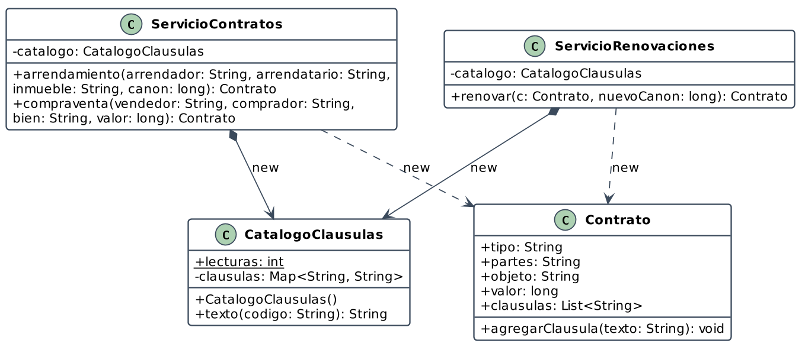

# Caso 02. Notaría digital: generación masiva de contratos

**Dominio:** Servicios legales (LegalTech)  
**Código inicial:** [`src/main/java/edu/ingsoft/actividad/creacionales/caso02/`](../../src/main/java/edu/ingsoft/actividad/creacionales/caso02/)

## 1. Contexto de la aplicación

«NotarIA» genera contratos (arrendamiento, compraventa y prestación de servicios) que luego se firman electrónicamente. Cada tipo de contrato se arma a partir de un catálogo de cláusulas que el área jurídica mantiene en una base de datos; leer el catálogo completo tarda alrededor de dos segundos.

Las inmobiliarias aliadas generan miles de contratos de arrendamiento al mes. Casi todos son idénticos salvo por las partes, el inmueble y el canon, y el área jurídica quiere crear nuevos tipos de contrato desde un panel de administración, sin esperar un despliegue.

## 2. Problemática

Cada servicio que necesita cláusulas crea su propio CatalogoClausulas, y cada instancia vuelve a leer la base de datos. Además, cada contrato se construye desde cero agregando una por una sus cláusulas, aunque el resultado base siempre sea el mismo para un tipo dado. Para ahorrar tiempo, un desarrollador intentó «copiar» un contrato ya armado y se produjo un error grave: dos clientes terminaron compartiendo la misma lista de cláusulas.

### Lo que reporta el equipo de desarrollo

- «El panel de métricas muestra cuatro lecturas completas del catálogo para generar tres contratos.»
- «Si el jurídico actualiza una cláusula, unos servicios la ven y otros no, porque cada uno tiene su copia.»
- «Para agregar el contrato de comodato hay que crear un método nuevo en ServicioContratos y desplegar.»
- «Al agregar una cláusula especial al contrato de un cliente apareció también en el de otro.»

## 3. Diagrama de clases inicial



> Fuente editable: [`diagrama-inicial.puml`](diagrama-inicial.puml) (PlantUML).

## 4. Código inicial

| Archivo | Ubicación |
|---|---|
| `CatalogoClausulas.java` | [`src/main/java/edu/ingsoft/actividad/creacionales/caso02/CatalogoClausulas.java`](../../src/main/java/edu/ingsoft/actividad/creacionales/caso02/CatalogoClausulas.java) |
| `Contrato.java` | [`src/main/java/edu/ingsoft/actividad/creacionales/caso02/Contrato.java`](../../src/main/java/edu/ingsoft/actividad/creacionales/caso02/Contrato.java) |
| `ServicioContratos.java` | [`src/main/java/edu/ingsoft/actividad/creacionales/caso02/ServicioContratos.java`](../../src/main/java/edu/ingsoft/actividad/creacionales/caso02/ServicioContratos.java) |
| `ServicioRenovaciones.java` | [`src/main/java/edu/ingsoft/actividad/creacionales/caso02/ServicioRenovaciones.java`](../../src/main/java/edu/ingsoft/actividad/creacionales/caso02/ServicioRenovaciones.java) |
| `Demo.java` | [`src/main/java/edu/ingsoft/actividad/creacionales/caso02/Demo.java`](../../src/main/java/edu/ingsoft/actividad/creacionales/caso02/Demo.java) |

Ejecutar el escenario actual:

```bash
scripts/ejecutar.sh caso02
```

Salida actual (también en [`salida-esperada.txt`](salida-esperada.txt)):

```text
ARRENDAMIENTO | Inmobiliaria Sol / Ana Ruiz | Apto 301, Medellín | $2,100,000 | 6 cláusulas: [Objeto del contrato, Duración y prórrogas, Forma de pago, Servicios públicos a cargo del arrendatario, Resolución de controversias, Duración y prórrogas (renovación)]
COMPRAVENTA | Luis Mora / Carlos Díaz | Vehículo ABC123 | $48,000,000 | 4 cláusulas: [Objeto del contrato, Forma de pago, Saneamiento por evicción, Resolución de controversias]
ARRENDAMIENTO | Inmobiliaria Sol / Ana Ruiz | Apto 301, Medellín | $2,250,000 | 6 cláusulas: [Objeto del contrato, Duración y prórrogas, Forma de pago, Servicios públicos a cargo del arrendatario, Resolución de controversias, Duración y prórrogas (renovación)]
Lecturas del catálogo: 3
```

## 5. Nuevos requerimientos del negocio

Después de refactorizar, el diseño debe permitir incorporar los siguientes cambios. Impleméntelos y demuéstrelos en una clase `DemoNuevosRequerimientos`:

1. Leer el catálogo de cláusulas una sola vez por ejecución y compartirlo de forma segura entre hilos.
2. Permitir registrar nuevos tipos de contrato en tiempo de ejecución (por ejemplo, «comodato») a partir de un contrato modelo.
3. Generar 1 000 contratos de arrendamiento sin volver a ensamblar las cláusulas base de cada uno.
4. Personalizar un contrato generado (agregar una cláusula especial) sin afectar a ningún otro contrato.

## 6. Preguntas orientadoras

1. ¿Cuántas instancias del catálogo necesita realmente el sistema? ¿Quién debería controlarlo?
2. ¿Qué diferencia hay entre construir un contrato desde cero y obtenerlo a partir de uno ya armado?
3. ¿Qué significa copiar un objeto que contiene una lista? ¿Qué debe copiarse y qué puede compartirse?
4. ¿Dónde se almacenarían los modelos de contrato y cómo se agregaría uno nuevo sin desplegar?

## 7. Entregables del caso

1. Informe `casos/caso-02-notaria-digital/INFORME.md` diligenciado a partir de [`PLANTILLA_INFORME.md`](../../PLANTILLA_INFORME.md).
2. Diagrama de clases de la solución en `casos/caso-02-notaria-digital/diagrama-solucion.puml` (y su PNG).
3. Código refactorizado en el paquete `edu.ingsoft.actividad.creacionales.caso02.solucion`, conservando el comportamiento correcto de `Demo` (verificable con `scripts/verificar.sh`; documente las diferencias que se deban a defectos corregidos).
4. Clase `DemoNuevosRequerimientos` que evidencie los cambios de la sección 5.

[← Volver a la actividad](../../README.md)
