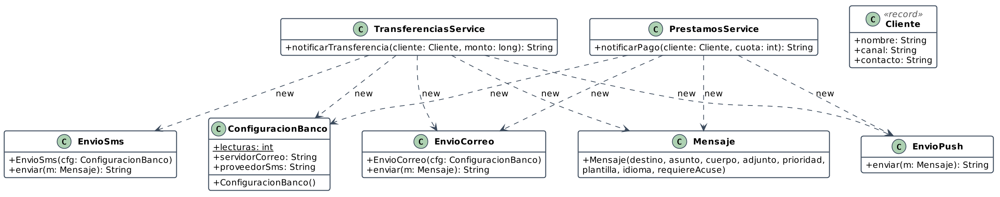

# Caso 03. Banca móvil: notificaciones transaccionales

**Dominio:** Servicios financieros (FinTech)  
**Código inicial:** [`src/main/java/edu/ingsoft/actividad/creacionales/caso03/`](../../src/main/java/edu/ingsoft/actividad/creacionales/caso03/)

## 1. Contexto de la aplicación

«BancoÁgil» notifica a sus clientes cada transferencia, pago de préstamo y alerta de seguridad. El cliente elige el canal (correo, SMS o notificación push) y los mensajes pueden llevar prioridad, plantilla, idioma y un comprobante adjunto.

La configuración de los canales (servidores, credenciales, límites) se lee de un archivo cifrado. La Superintendencia Financiera exige que todas las notificaciones usen exactamente la misma configuración vigente y que se pueda auditar cuál se usó.

## 2. Problemática

Cada servicio de negocio (transferencias, préstamos) decide con un switch qué clase de envío instanciar según el canal del cliente y lee de nuevo el archivo de configuración. Los mensajes se crean con un constructor de ocho parámetros, varios de ellos nulos u opcionales, y el código se llenó de llamadas difíciles de leer como new Mensaje(x, y, z, null, 1, null, "es", false).

### Lo que reporta el equipo de desarrollo

- «Agregar WhatsApp como canal significa modificar el switch en cada servicio.»
- «En una prueba de carga el archivo de configuración se leyó miles de veces.»
- «Nadie recuerda qué significa el quinto parámetro de Mensaje.»
- «Un servicio olvidó el caso SMS y los clientes que eligieron ese canal no recibieron nada.»

## 3. Diagrama de clases inicial



> Fuente editable: [`diagrama-inicial.puml`](diagrama-inicial.puml) (PlantUML).

## 4. Código inicial

| Archivo | Ubicación |
|---|---|
| `Cliente.java` | [`src/main/java/edu/ingsoft/actividad/creacionales/caso03/Cliente.java`](../../src/main/java/edu/ingsoft/actividad/creacionales/caso03/Cliente.java) |
| `ConfiguracionBanco.java` | [`src/main/java/edu/ingsoft/actividad/creacionales/caso03/ConfiguracionBanco.java`](../../src/main/java/edu/ingsoft/actividad/creacionales/caso03/ConfiguracionBanco.java) |
| `Mensaje.java` | [`src/main/java/edu/ingsoft/actividad/creacionales/caso03/Mensaje.java`](../../src/main/java/edu/ingsoft/actividad/creacionales/caso03/Mensaje.java) |
| `EnvioCorreo.java` | [`src/main/java/edu/ingsoft/actividad/creacionales/caso03/EnvioCorreo.java`](../../src/main/java/edu/ingsoft/actividad/creacionales/caso03/EnvioCorreo.java) |
| `EnvioSms.java` | [`src/main/java/edu/ingsoft/actividad/creacionales/caso03/EnvioSms.java`](../../src/main/java/edu/ingsoft/actividad/creacionales/caso03/EnvioSms.java) |
| `EnvioPush.java` | [`src/main/java/edu/ingsoft/actividad/creacionales/caso03/EnvioPush.java`](../../src/main/java/edu/ingsoft/actividad/creacionales/caso03/EnvioPush.java) |
| `TransferenciasService.java` | [`src/main/java/edu/ingsoft/actividad/creacionales/caso03/TransferenciasService.java`](../../src/main/java/edu/ingsoft/actividad/creacionales/caso03/TransferenciasService.java) |
| `PrestamosService.java` | [`src/main/java/edu/ingsoft/actividad/creacionales/caso03/PrestamosService.java`](../../src/main/java/edu/ingsoft/actividad/creacionales/caso03/PrestamosService.java) |
| `Demo.java` | [`src/main/java/edu/ingsoft/actividad/creacionales/caso03/Demo.java`](../../src/main/java/edu/ingsoft/actividad/creacionales/caso03/Demo.java) |

Ejecutar el escenario actual:

```bash
scripts/ejecutar.sh caso03
```

Salida actual (también en [`salida-esperada.txt`](salida-esperada.txt)):

```text
EMAIL via smtp.bancoagil.co -> ana@correo.co: Transferencia por $500000 (p2, es, adj=comprobante.pdf)
SMS via sms-gw-2 -> 3001234567: Transferencia por $80000
PUSH -> device-77: Pago cuota 7
(sin notificación para canal SMS)
Lecturas de configuración: 4
```

## 5. Nuevos requerimientos del negocio

Después de refactorizar, el diseño debe permitir incorporar los siguientes cambios. Impleméntelos y demuéstrelos en una clase `DemoNuevosRequerimientos`:

1. Agregar el canal WhatsApp sin modificar TransferenciasService ni PrestamosService.
2. Leer la configuración una sola vez y exponer su versión para la auditoría.
3. Construir mensajes con valores por defecto (prioridad NORMAL, idioma «es») y validar que todo mensaje de prioridad ALTA tenga plantilla.
4. Permitir que un banco aliado (marca blanca) registre su propio canal en tiempo de ejecución.

## 6. Preguntas orientadoras

1. ¿Qué parte del código cambia cuando aparece un canal nuevo? ¿Cómo aislarla?
2. ¿Cuántas configuraciones deberían existir en memoria? ¿Qué riesgos tiene compartirla?
3. ¿Cómo haría legible y segura la creación de un mensaje con muchos campos opcionales?
4. ¿Qué ventajas tendría registrar canales en lugar de enumerarlos en el código?

## 7. Entregables del caso

1. Informe `casos/caso-03-banca-movil/INFORME.md` diligenciado a partir de [`PLANTILLA_INFORME.md`](../../PLANTILLA_INFORME.md).
2. Diagrama de clases de la solución en `casos/caso-03-banca-movil/diagrama-solucion.puml` (y su PNG).
3. Código refactorizado en el paquete `edu.ingsoft.actividad.creacionales.caso03.solucion`, conservando el comportamiento correcto de `Demo` (verificable con `scripts/verificar.sh`; documente las diferencias que se deban a defectos corregidos).
4. Clase `DemoNuevosRequerimientos` que evidencie los cambios de la sección 5.

[← Volver a la actividad](../../README.md)
