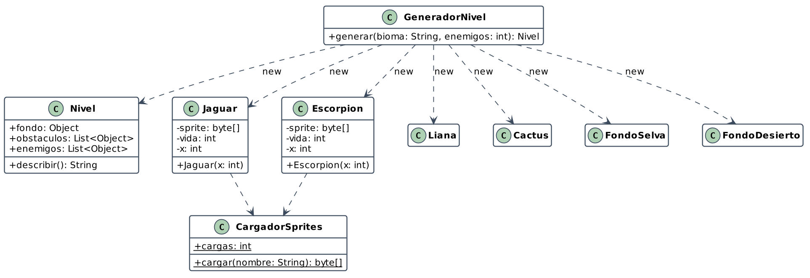

# Caso 04. Videojuego educativo: niveles por bioma

**Dominio:** Videojuegos educativos  
**Código inicial:** [`src/main/java/edu/ingsoft/actividad/creacionales/caso04/`](../../src/main/java/edu/ingsoft/actividad/creacionales/caso04/)

## 1. Contexto de la aplicación

«Explora Colombia» es un videojuego de plataformas para colegios que enseña sobre los ecosistemas del país. Cada nivel pertenece a un bioma (selva o desierto) y contiene enemigos, obstáculos y un fondo propios de ese bioma; mezclar elementos de biomas distintos rompe la coherencia pedagógica del juego.

Cada enemigo carga un sprite (imagen) y una tabla de animaciones, una operación costosa en los computadores de los colegios. Los niveles avanzados generan oleadas de cientos de enemigos casi idénticos, que solo difieren en su posición y, a veces, en su velocidad.

## 2. Problemática

GeneradorNivel usa condicionales sobre el nombre del bioma para elegir qué enemigo, qué obstáculo y qué fondo crear, y en una rama olvidada aparece un obstáculo de selva en el desierto. Para cada enemigo de una oleada se ejecuta el constructor completo, que vuelve a cargar el sprite desde disco: una oleada de 300 enemigos tarda varios segundos en los equipos escolares.

### Lo que reporta el equipo de desarrollo

- «El nivel de desierto muestra lianas, que solo existen en la selva.»
- «El perfilador indica que el 80 % del tiempo de carga se va en el constructor de los enemigos.»
- «Para el bioma páramo hay que tocar cada if de GeneradorNivel.»
- «Los enemigos élite son iguales a los normales pero con más vida; hoy se crean copiando y pegando el constructor.»

## 3. Diagrama de clases inicial



> Fuente editable: [`diagrama-inicial.puml`](diagrama-inicial.puml) (PlantUML).

## 4. Código inicial

| Archivo | Ubicación |
|---|---|
| `CargadorSprites.java` | [`src/main/java/edu/ingsoft/actividad/creacionales/caso04/CargadorSprites.java`](../../src/main/java/edu/ingsoft/actividad/creacionales/caso04/CargadorSprites.java) |
| `Jaguar.java` | [`src/main/java/edu/ingsoft/actividad/creacionales/caso04/Jaguar.java`](../../src/main/java/edu/ingsoft/actividad/creacionales/caso04/Jaguar.java) |
| `Escorpion.java` | [`src/main/java/edu/ingsoft/actividad/creacionales/caso04/Escorpion.java`](../../src/main/java/edu/ingsoft/actividad/creacionales/caso04/Escorpion.java) |
| `Liana.java` | [`src/main/java/edu/ingsoft/actividad/creacionales/caso04/Liana.java`](../../src/main/java/edu/ingsoft/actividad/creacionales/caso04/Liana.java) |
| `Cactus.java` | [`src/main/java/edu/ingsoft/actividad/creacionales/caso04/Cactus.java`](../../src/main/java/edu/ingsoft/actividad/creacionales/caso04/Cactus.java) |
| `FondoSelva.java` | [`src/main/java/edu/ingsoft/actividad/creacionales/caso04/FondoSelva.java`](../../src/main/java/edu/ingsoft/actividad/creacionales/caso04/FondoSelva.java) |
| `FondoDesierto.java` | [`src/main/java/edu/ingsoft/actividad/creacionales/caso04/FondoDesierto.java`](../../src/main/java/edu/ingsoft/actividad/creacionales/caso04/FondoDesierto.java) |
| `Nivel.java` | [`src/main/java/edu/ingsoft/actividad/creacionales/caso04/Nivel.java`](../../src/main/java/edu/ingsoft/actividad/creacionales/caso04/Nivel.java) |
| `GeneradorNivel.java` | [`src/main/java/edu/ingsoft/actividad/creacionales/caso04/GeneradorNivel.java`](../../src/main/java/edu/ingsoft/actividad/creacionales/caso04/GeneradorNivel.java) |
| `Demo.java` | [`src/main/java/edu/ingsoft/actividad/creacionales/caso04/Demo.java`](../../src/main/java/edu/ingsoft/actividad/creacionales/caso04/Demo.java) |

Ejecutar el escenario actual:

```bash
scripts/ejecutar.sh caso04
```

Salida actual (también en [`salida-esperada.txt`](salida-esperada.txt)):

```text
Selva:    FondoSelva | obstáculos=[Liana, Liana, Liana] | enemigos=300 | primero=Jaguar(vida=30,x=0,sprite=64KB)
Desierto: FondoDesierto | obstáculos=[Cactus, Cactus, Liana] | enemigos=300 | primero=Escorpion(vida=15,x=0,sprite=64KB)
Sprites cargados desde disco: 600 (≈ 37 MB leídos)
```

## 5. Nuevos requerimientos del negocio

Después de refactorizar, el diseño debe permitir incorporar los siguientes cambios. Impleméntelos y demuéstrelos en una clase `DemoNuevosRequerimientos`:

1. Agregar el bioma «páramo» (oso de anteojos, frailejón como obstáculo, fondo de niebla) sin modificar GeneradorNivel.
2. Generar oleadas de 1 000 enemigos cargando el sprite una sola vez por tipo de enemigo.
3. Crear variantes «élite» (doble de vida) de cualquier enemigo a partir de un enemigo modelo.
4. Garantizar que todos los elementos de un nivel pertenezcan al mismo bioma.

## 6. Preguntas orientadoras

1. ¿Qué objetos deben crearse siempre juntos? ¿Qué pasa si se mezclan?
2. ¿Qué parte del estado de un enemigo es costosa de crear y cuál varía entre enemigos?
3. ¿Cómo obtendría muchos objetos casi iguales sin repetir el trabajo costoso?
4. ¿Cómo se elegiría el bioma una sola vez para todo el nivel?

## 7. Entregables del caso

1. Informe `casos/caso-04-videojuego-biomas/INFORME.md` diligenciado a partir de [`PLANTILLA_INFORME.md`](../../PLANTILLA_INFORME.md).
2. Diagrama de clases de la solución en `casos/caso-04-videojuego-biomas/diagrama-solucion.puml` (y su PNG).
3. Código refactorizado en el paquete `edu.ingsoft.actividad.creacionales.caso04.solucion`, conservando el comportamiento correcto de `Demo` (verificable con `scripts/verificar.sh`; documente las diferencias que se deban a defectos corregidos).
4. Clase `DemoNuevosRequerimientos` que evidencie los cambios de la sección 5.

[← Volver a la actividad](../../README.md)
