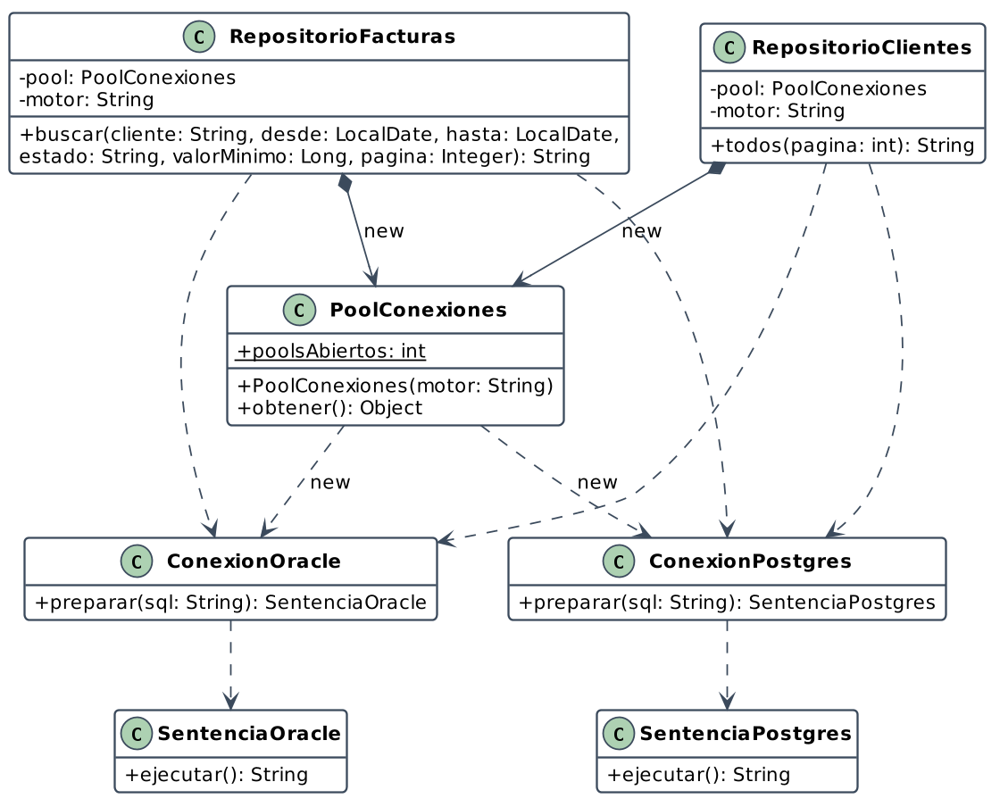

# Caso 05. ERP para pymes: acceso a datos multimotor

**Dominio:** Sistemas empresariales (ERP)  
**Código inicial:** [`src/main/java/edu/ingsoft/actividad/creacionales/caso05/`](../../src/main/java/edu/ingsoft/actividad/creacionales/caso05/)

## 1. Contexto de la aplicación

«PymERP» es un ERP que se instala en las empresas clientes. Según la infraestructura de cada cliente, el producto funciona sobre PostgreSQL o sobre Oracle. Cada motor tiene su propio tipo de conexión, su forma de crear sentencias y su sintaxis para paginar resultados.

El módulo de facturación consulta facturas con filtros opcionales (cliente, rango de fechas, estado, valor mínimo), orden y paginación. Abrir un pool de conexiones cuesta varios segundos y el motor de base de datos limita el número de conexiones simultáneas.

## 2. Problemática

Cada repositorio crea su propio PoolConexiones y decide con condicionales qué clase de conexión y de sentencia usar según el motor configurado. Las consultas se arman concatenando cadenas con muchos if, y la paginación de Oracle se escribe con la sintaxis de PostgreSQL en uno de los repositorios, lo que provoca errores solo en los clientes con Oracle.

### Lo que reporta el equipo de desarrollo

- «En producción se abren tres pools donde debería haber uno y el DBA nos pide reducir conexiones.»
- «Para soportar SQL Server habría que tocar cada repositorio.»
- «El método de búsqueda de facturas tiene seis parámetros que pueden ser null.»
- «Un cliente con Oracle reportó un error de sintaxis por un LIMIT que no debía estar ahí.»

## 3. Diagrama de clases inicial



> Fuente editable: [`diagrama-inicial.puml`](diagrama-inicial.puml) (PlantUML).

## 4. Código inicial

| Archivo | Ubicación |
|---|---|
| `SentenciaPostgres.java` | [`src/main/java/edu/ingsoft/actividad/creacionales/caso05/SentenciaPostgres.java`](../../src/main/java/edu/ingsoft/actividad/creacionales/caso05/SentenciaPostgres.java) |
| `SentenciaOracle.java` | [`src/main/java/edu/ingsoft/actividad/creacionales/caso05/SentenciaOracle.java`](../../src/main/java/edu/ingsoft/actividad/creacionales/caso05/SentenciaOracle.java) |
| `ConexionPostgres.java` | [`src/main/java/edu/ingsoft/actividad/creacionales/caso05/ConexionPostgres.java`](../../src/main/java/edu/ingsoft/actividad/creacionales/caso05/ConexionPostgres.java) |
| `ConexionOracle.java` | [`src/main/java/edu/ingsoft/actividad/creacionales/caso05/ConexionOracle.java`](../../src/main/java/edu/ingsoft/actividad/creacionales/caso05/ConexionOracle.java) |
| `PoolConexiones.java` | [`src/main/java/edu/ingsoft/actividad/creacionales/caso05/PoolConexiones.java`](../../src/main/java/edu/ingsoft/actividad/creacionales/caso05/PoolConexiones.java) |
| `RepositorioFacturas.java` | [`src/main/java/edu/ingsoft/actividad/creacionales/caso05/RepositorioFacturas.java`](../../src/main/java/edu/ingsoft/actividad/creacionales/caso05/RepositorioFacturas.java) |
| `RepositorioClientes.java` | [`src/main/java/edu/ingsoft/actividad/creacionales/caso05/RepositorioClientes.java`](../../src/main/java/edu/ingsoft/actividad/creacionales/caso05/RepositorioClientes.java) |
| `Demo.java` | [`src/main/java/edu/ingsoft/actividad/creacionales/caso05/Demo.java`](../../src/main/java/edu/ingsoft/actividad/creacionales/caso05/Demo.java) |

Ejecutar el escenario actual:

```bash
scripts/ejecutar.sh caso05
```

Salida actual (también en [`salida-esperada.txt`](salida-esperada.txt)):

```text
[PostgreSQL] SELECT * FROM factura WHERE 1=1 AND cliente = '900123' AND fecha BETWEEN '2026-01-01' AND '2026-06-30' AND estado = 'PAGADA' ORDER BY fecha DESC LIMIT 20 OFFSET 20
[PostgreSQL] SELECT * FROM factura WHERE 1=1 AND total >= 1000000 ORDER BY fecha DESC
[PostgreSQL] SELECT * FROM cliente ORDER BY nombre LIMIT 20 OFFSET 0
[Oracle] ORA-00933: SQL command not properly ended -> SELECT * FROM factura WHERE 1=1 AND cliente = '900123' AND fecha BETWEEN '2026-01-01' AND '2026-06-30' AND estado = 'PAGADA' ORDER BY fecha DESC LIMIT 20 OFFSET 20
[Oracle] SELECT * FROM factura WHERE 1=1 AND total >= 1000000 ORDER BY fecha DESC
[Oracle] SELECT * FROM cliente ORDER BY nombre OFFSET 0 ROWS FETCH NEXT 20 ROWS ONLY
Pools abiertos: 4
```

## 5. Nuevos requerimientos del negocio

Después de refactorizar, el diseño debe permitir incorporar los siguientes cambios. Impleméntelos y demuéstrelos en una clase `DemoNuevosRequerimientos`:

1. Usar un único pool de conexiones compartido por todos los repositorios.
2. Agregar soporte para SQL Server (conexión, sentencia y paginación TOP/OFFSET) sin modificar los repositorios.
3. Construir consultas de facturas combinando filtros opcionales de forma legible y validando que la página sea mayor que cero.
4. Garantizar que conexión, sentencia y paginación siempre correspondan al mismo motor.

## 6. Preguntas orientadoras

1. ¿Qué objetos dependen del motor de base de datos y deben ser compatibles entre sí?
2. ¿Cuántos pools de conexiones necesita la aplicación? ¿Qué riesgos implica compartirlo?
3. ¿Cómo construiría una consulta con muchos filtros opcionales sin concatenaciones frágiles?
4. ¿Qué parte de la construcción de la consulta depende del motor y cuál no?

## 7. Entregables del caso

1. Informe `casos/caso-05-erp-multimotor/INFORME.md` diligenciado a partir de [`PLANTILLA_INFORME.md`](../../PLANTILLA_INFORME.md).
2. Diagrama de clases de la solución en `casos/caso-05-erp-multimotor/diagrama-solucion.puml` (y su PNG).
3. Código refactorizado en el paquete `edu.ingsoft.actividad.creacionales.caso05.solucion`, conservando el comportamiento correcto de `Demo` (verificable con `scripts/verificar.sh`; documente las diferencias que se deban a defectos corregidos).
4. Clase `DemoNuevosRequerimientos` que evidencie los cambios de la sección 5.

[← Volver a la actividad](../../README.md)
